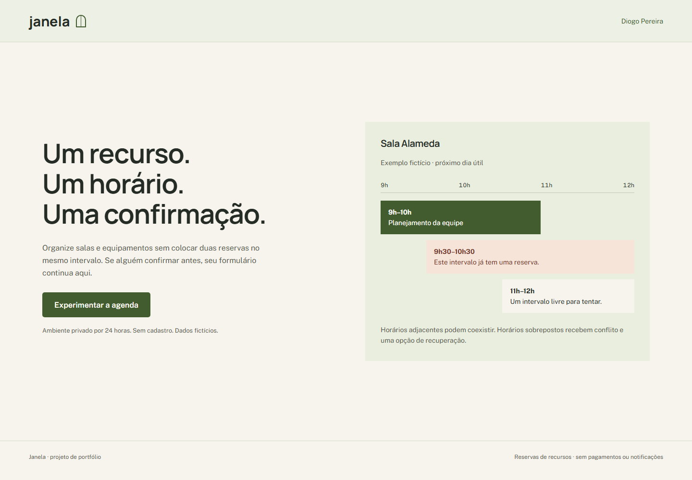
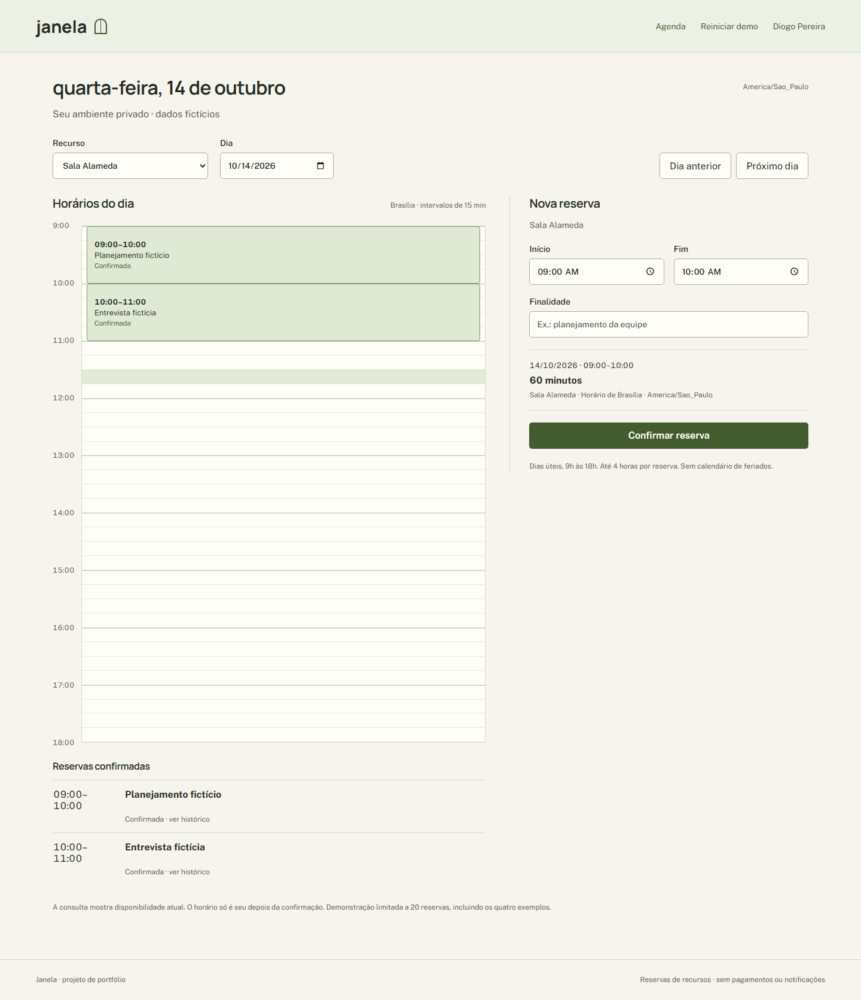

# Janela

Reserva de espaços e equipamentos com React, Node.js/TypeScript e PostgreSQL.
Projeto de portfólio de Diogo Pereira, em implementação na pasta3.

O fluxo planejado permite reservar, remarcar, cancelar e consultar histórico.
A regra central será impedir sobreposição no banco, incluindo confirmação
simultânea, e explicar o conflito sem descartar o formulário.

[Especificação](docs/superpowers/specs/2026-10-10-janela-design.md).

Não há aplicação publicada nesta etapa. Demonstração e
dados serão fictícios; sem pagamentos, feriados, recorrência ou calendário externo.

## Fundação verificada

O backend possui configuração explícita de ambiente, pool PostgreSQL limitado,
migrations transacionais com checksum e endpoint `/health/ready`. A prontidão
retorna 503 antes das migrations e 200 após sua aplicação; não executa migrations
durante o startup. Produção exige HTTPS, TLS verificado no banco e segredo de sessão.

Em 13/10/2026 passaram 39 testes locais, incluindo HTTP real, PostgreSQL e
processos independentes para a prova de exclusão. Tipagem TypeScript, formatação
e build React/Node passaram. Acesso, criação, remarcação e cancelamento estão
implementados, com dez testes frontend. O navegador local percorreu iniciar,
criar, remarcar, cancelar e recarregar o histórico. Capturas desktop1440/mobile390
tiveram axe0, sem overflow horizontal ou erro JavaScript. CI e hospedagem pendentes.

Os três cenários Playwright passaram juntos no banco isolado de teste. Evidências
e limites em [verificação local](docs/evidence/verification.md). No Windows
preparado, `./scripts/verify.ps1` executa todos os checks e migrations somente
em `janela_test`.

Contratos: [acesso](docs/contracts/access.md) e [reservas](docs/contracts/reservations.md).

Interface: [sistema de design](DESIGN.md), fontes locais com licenças e agenda
proporcional no desktop; no celular, reservas aparecem como registros rotulados.

Requisitos: Node 24.15 ou superior da série 24, npm 11.12.1 e PostgreSQL 17.
Instale com `npm ci`, configure as variáveis de `.env.example`, aplique
`npm run migrate` explicitamente e use `npm run dev`. Para os testes de integração,
use uma role e banco separados `janela_test` em `127.0.0.1`, informados em
`JANELA_TEST_DATABASE_URL`. Os scripts PowerShell locais preparam esse ambiente
sem versionar credenciais. `npm run typecheck` e `npm run build` verificam a compilação.
